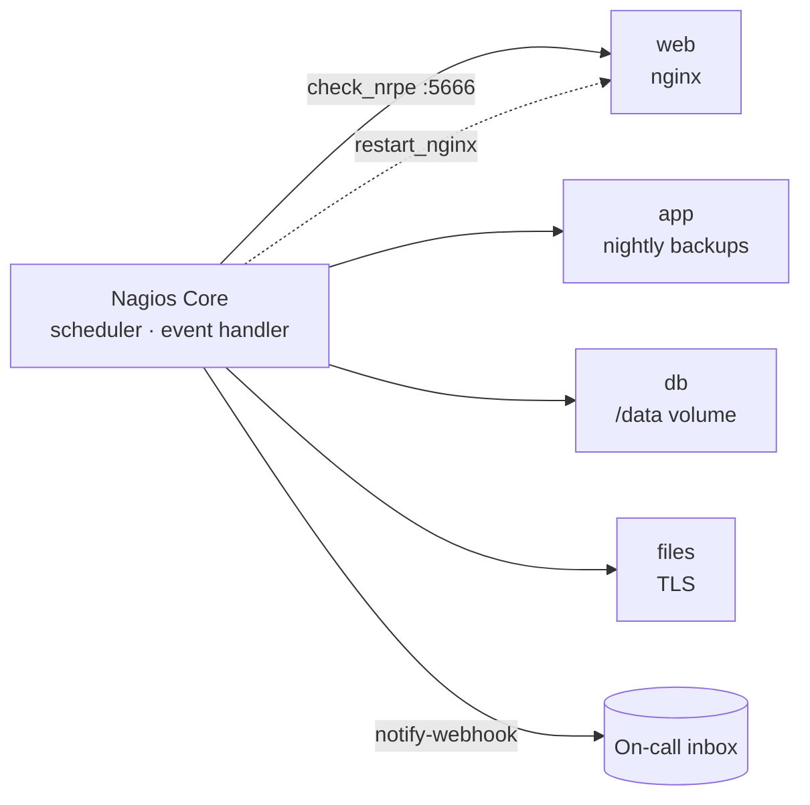

# Proactive monitoring with Nagios

**Nagios Core** watches four Linux servers through the **NRPE** agent, using stock plugins plus **custom Bash checks**.
Every push plants real faults on the servers, then proves Nagios **caught each one within seconds**, **alerted on-call**, and that it **recovered**. One fault heals itself, with no human involved.

[Live pipeline →](https://danielkojomegbenu.com/projects/nagios-monitoring)

## The estate



| Host | What is checked | How |
|---|---|---|
| all four | Load, root disk, host alive | `check_load`, `check_disk` via NRPE; `check_tcp` to :5666 |
| **web** | HTTP and the nginx process | `check_http` from Nagios; `check_procs` via NRPE |
| **app** | Age of the newest backup | custom `check_backup_age` (WARNING at 24h, CRITICAL at 26h) |
| **db** | Free space on `/data` | `check_disk` (WARNING below 20% free, CRITICAL below 10%) |
| **files** | Days until the TLS certificate expires | custom `check_cert_expiry` (WARNING under 30 days, CRITICAL under 7) |

That's 13 services in total. The config is in Git (`nagios/objects/`, and the thresholds in `hosts/nrpe/estate.cfg`), and every run checks it with `nagios -v` before anything starts.

## What every run proves

| Step | Fault planted | Nagios must… | Then |
|---|---|---|---|
| Baseline | none | report all 13 services OK | |
| web | `nginx` is killed | alert HTTP CRITICAL | the **event handler** restarts nginx over NRPE on its own, and RECOVERY is sent |
| app | the backups go 3 days stale | alert Backup age CRITICAL | the operator runs the backup, and RECOVERY is sent |
| db | a runaway log fills `/data` to 94% | alert Data disk CRITICAL | the log is removed, and RECOVERY is sent |
| files | the certificate is reissued with 3 days left | alert TLS cert CRITICAL | the certificate is renewed, and RECOVERY is sent |
| All clear | | report all 13 services OK again | the on-call inbox is summarised |

A fault fails the run if no alert reaches on-call within **45 seconds**, or if it doesn't recover within 60.
Detection usually takes 4-13 seconds. `interval_length=1` makes Nagios intervals seconds rather than minutes so a run fits in CI; a real estate would keep the default.

Self-healing is deliberately narrow: NRPE has exactly one command that changes anything (`restart_nginx`), backed by one sudo rule for `/usr/sbin/nginx`. It only fires once the failure is confirmed (HARD CRITICAL), so on-call still gets the PROBLEM alert, then the RECOVERY.

## See a "quieter alerts" change fail the run

Open the pull request **demo/quieter-disk-alerts**. To cut noise, it lowers the `/data` thresholds to warn at 3% free and go critical at 1%.
The disk fills to 94% and Nagios still says OK, so on-call is never told. The **db** step fails after 45 seconds of silence.

## Run it on your machine (Linux)

```bash
docker compose up -d --build
python3 checks/verify.py baseline
for h in web app db files; do python3 checks/verify.py fault $h; done
python3 checks/verify.py allclear
docker compose down
```

## What's in the repo

| Path | What it is |
|---|---|
| `nagios/` | The Nagios server image, `nagios.cfg`, the object files, the webhook notifier and the event handler |
| `hosts/` | The monitored server image: NRPE, its commands and thresholds, and the custom Bash plugins |
| `inbox/inbox.py` | The on-call inbox that receives Nagios notifications |
| `checks/verify.py` | Plants each fault and checks detection, alerting and recovery |
| `.github/workflows/monitoring.yml` | The pipeline |

## Cost

Free. Everything runs on the GitHub runner, and GitHub Actions is free for public repos.
